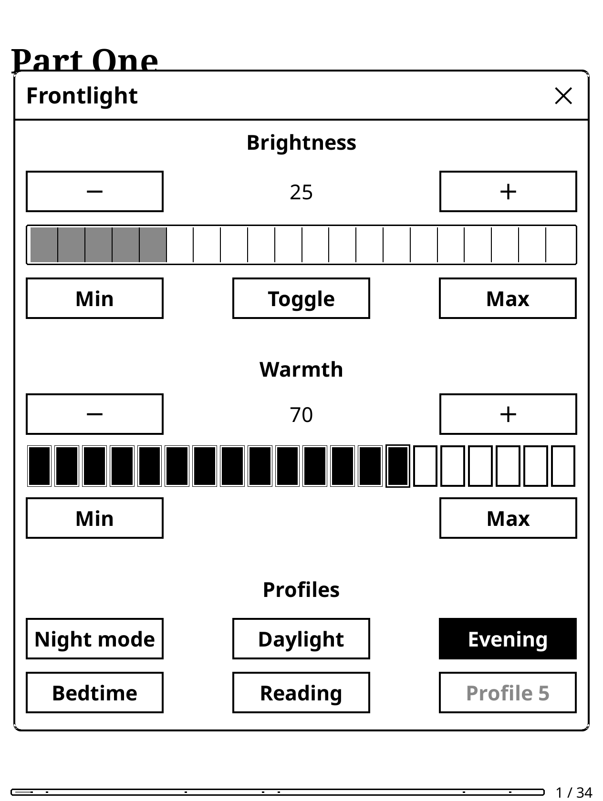
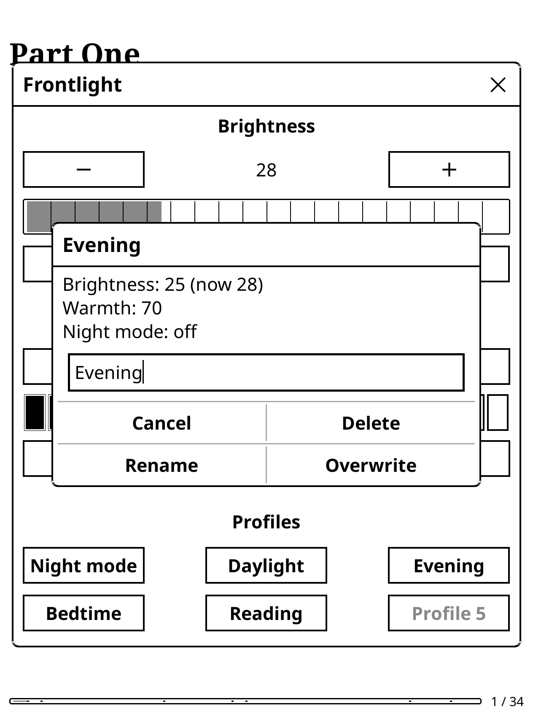

# KOReader Light Profiles

A user patch for [KOReader](https://github.com/koreader/koreader) that adds a **Night mode** button and **5 savable light profiles** to the built-in Frontlight dialog, and makes every saved profile available as a **shortcut action** for gestures, hotkeys and other plugins.

Based on the original patch by [@peterboda236](https://github.com/peterboda236/koreader-user-patches).

  
  

---

## Features

- **One-tap profiles.** Each profile stores brightness, warmth (on devices with warm light) and night mode. Tap it to apply all three at once.
- **See what's active.** The profile matching the current light is shown highlighted, and so is **Night mode** while it's on. Change the light by hand and the highlight goes away.
- **Empty slots are grey.** Tap one to save the current light into it.
- **Long-press to manage.** Long-press a saved profile to **rename**, **overwrite** it with the current light, or **delete** it. The dialog shows what's saved next to what the light is now.
- **Shortcuts.** Every saved profile becomes a KOReader action called **Light profile: \<name\>**. Renaming a profile keeps its shortcuts working.
- **Fits the screen.** In landscape the buttons go on a single row, so the dialog never runs off the screen.

---

## Installation

1. Download `2-frontlight-widget-profiles.lua`.
2. Copy it into KOReader's `patches` folder:
   - Kobo: `.adds/koreader/patches/`
   - Kindle: `koreader/patches/`
   - Other devices: `<koreader folder>/patches/`

   Create the `patches` folder if it doesn't exist.
3. Restart KOReader.

To check that it loaded, go to **Tools → More tools → Patch management → After setup**. The patch should be listed with a checkmark.

> **Don't use it together with `2-frontlight-widget-nightmode.lua`.** This patch already includes the night mode button, so you'd get two.

**Upgrading from v1.0.x:** replace the old file. Your saved profiles and names carry over.

---

## Usage

Open the Frontlight dialog from **Settings (gear) → Frontlight**, or with a gesture set to **Show frontlight dialog**. The **Profiles** section is at the bottom.

| Action | Result |
| --- | --- |
| Tap a saved profile | Applies its brightness, warmth and night mode |
| Tap an empty (grey) slot | Saves the current light into it |
| Long-press a profile | Rename, overwrite or delete it |
| Tap **Night mode** | Turns night mode on or off |

### Setting up a shortcut

Save a profile first; only saved profiles appear as actions.

1. Go to **Settings (gear) → Taps and gestures → Gesture manager**.
2. Pick a gesture, for example a corner tap or a two-finger swipe.
3. Open **Screen and lights** and tick **Light profile: \<name\>**.

The same actions show up anywhere KOReader lets you pick an action: hotkeys, profiles, the quick menu, and plugins that list system actions, such as SimpleUI's quick actions. A short notification confirms which profile was applied.

---

## Compatibility

- Tested with KOReader v2024.11, v2025.04 and v2026.07.
- Works with or without warm light. Warmth is only saved and restored on devices that have it.
- Interface text follows KOReader's language. The few extra texts are in English and Hungarian.

---

## Changelog

**v1.1.0** (stevenzamora1)
- Profile names are shown on the buttons themselves; the current profile and night mode are highlighted, and empty slots are grey.
- Long-press menu with rename, overwrite and delete.
- Every saved profile is available as a shortcut action.
- Landscape layout: the dialog no longer runs off the screen.
- Night mode is switched through KOReader itself, so its refresh settings and book rendering stay in sync.
- Applying a profile updates the dialog in place instead of closing and reopening it.

**v1.0.0 – v1.0.3** (peterboda236)
- Original patch: night mode toggle and 5 savable light profiles.

---

## Credits

- Original patch: [@peterboda236](https://github.com/peterboda236/koreader-user-patches), which credits patches by [@quanganhdo](https://github.com/quanganhdo/koreader-user-patches).
- v1.1.0: [@stevenzamora1](https://github.com/stevenzamora1).
